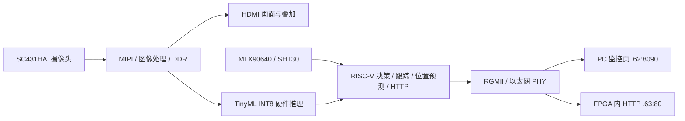
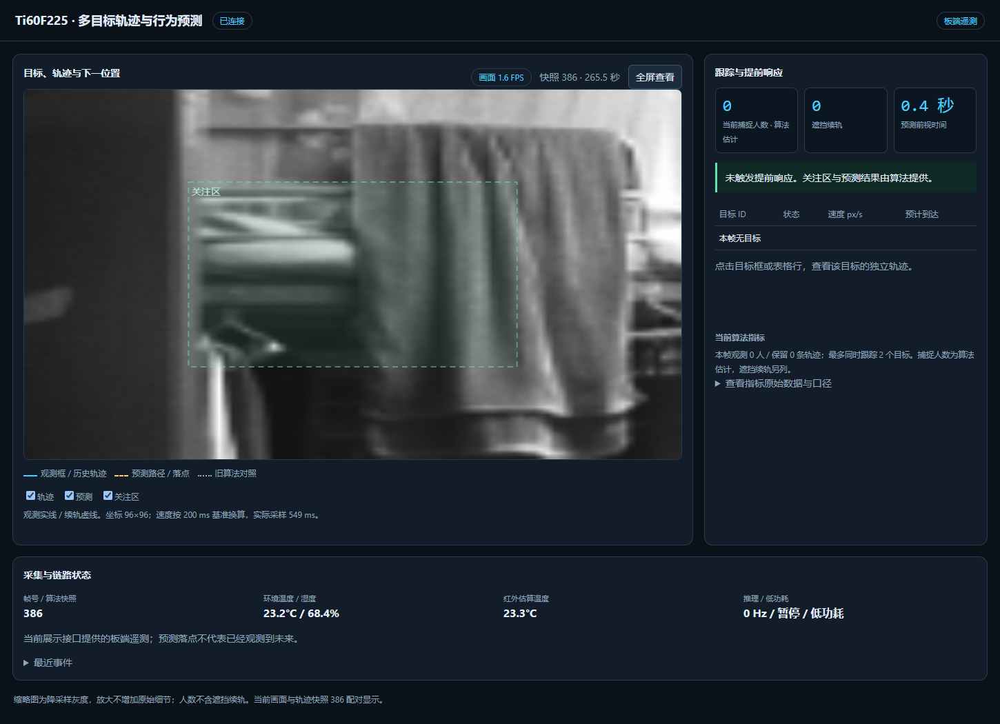

# Ti60F225 多模态 AI 智能终端

易灵思赛道 · 赛题三 · **入侵检测与轨迹预警场景**。在 FPGA 上完成摄像头采集、TinyML 硬件推理和 RISC-V 决策。HDMI 展示实时画面与 OSD，两种 Web 入口展示监控画面、目标轨迹和传感器状态。

## 评委从这里开始

| 阅读顺序 | 入口 | 内容 |
|---|---|---|
| 1 | [演示与验收](docs/review/ACCEPTANCE.md) | 5–10 分钟演示步骤、两端网页、观察项与记录方式 |
| 2 | [赛题功能对照](docs/review/FEATURES.md) | 基础任务、七项拓展、实现程度和验收边界 |
| 3 | [证据与结果](docs/review/EVIDENCE.md) | 当前实测数据、截图、测试报告；历史记录分列 |
| 4 | [构建与运行](docs/review/REPRODUCE.md) | 从仓库源码构建、JTAG/UART 加载及 PC 网页启动 |

本轮整理日期为 **2026-11-04**；运行基线来自同日已保存的上板记录。本轮整理不新增现场验收结论。源码与依赖集中在 [project/current](project/current/README.md)，当前可用二进制在 [firmware](firmware/README.md)。

## 系统组成

人体检测使用 96×96 灰度 INT8 模型；轨迹候选由背景差分与连通域产生，RISC-V 完成关联、速度估计和位置外推。网页中的人数是算法估计，预测点表示外推结果。

## 当前版本与结果

| 项目 | 当前值 / 证据 |
|---|---|
| 板卡 / 摄像头 | Ti60F225 DemoBoard V4 / SC431HAI |
| 当前应用 | [tinyml_pdti8.bin](firmware/tinyml_pdti8.bin)，438,506 字节，CRC32 **B42CC161**；[完整标识](firmware/firmware_identity.json) |
| 当前位流 | [netfix04_rxq2_seed1.bit](firmware/netfix04_rxq2_seed1.bit)，SHA256 **865458AB…DF0E69F5** |
| 网页入口 | PC：`http://169.254.47.62:8090/`；板内：`http://169.254.47.63/`，需连接演示局域网 |
| 双端网页 | 同源 [page.html](tools/page.html)，显示人数、ID、轨迹、速度、400ms 预测和传感状态 |
| 实际新画面刷新率 | PC **2.20 FPS**（44 张 / 20.01s）；板内 **2.00 FPS**（20 张 / 10.01s）；[原始测量](evidence/preview_fps_20261104/measurements/after_fw2/measurement.json) |
| 取像修复 | 固定左右拼接偏移已修复；帧地址回归 1080 行通过；[地址审计](evidence/preview_fps_20261104/FRAME_LAYOUT_AUDIT.md) |
| 多目标与预测 | 最多 **2 个目标**，按实际采样间隔估速、外推 400ms；[实现与限制](docs/review/FEATURES.md) |
| 工具环境 | 本机实际 Efinity **2026.1.132**，RISC-V GCC **15.2.0-1**；尚未验证 Efinity 2025.1 重建 |

刷新率按浏览器绘制的新 capture ID 计数，重复显示缓存图不计入；测量窗口、场景与功耗状态影响结果，不能当成固定视频帧率或 HDMI 帧率。当前预览原始分辨率为 96×96 灰度，按 16:9 场景比例显示。

*2026-11-04 板端实拍快照，此时为空场、人数为 0；截图瞬时 FPS 不代表上表窗口统计。轨迹显示示例与合成测试见[证据索引](docs/review/EVIDENCE.md)。*

## 验收范围

- 已保存摄像头/HDMI、网口与双端网页、算法回归和画面刷新率记录。完整对应关系见[赛题对照](docs/review/FEATURES.md)。
- 多目标实拍历史数据缺少人工框和 ID 真值，尚未完成真人交叉遮挡现场验收；合成数据指标单独列出。
- 红外为相对热变化与估算温度，尚未完成 EEPROM 温度校准。白平衡仍需优化。
- 低功耗具有暂停推理等逻辑，摄像头降帧在当前配置中关闭；SPI 语音播报未完成，板内事件历史未完成。
- 当前位流 setup 余量 **−1.103ns**，尚未闭合；固定 bank 尚未加入完成帧读锁。当前采用临时 JTAG 位流与 UART RAM 应用，断电需重载。

## 源码与资料位置

| 位置 | 用途 |
|---|---|
| [project/current/](project/current/README.md) | 当前完整 Efinity 工程、官方软件依赖与来源清单 |
| [evidence/v30_mot/](evidence/v30_mot/) | 当前 RISC-V 应用、IoU 跟踪、预测与 HTTP/TCP 源码，路径为历史沿用 |
| [tools/](tools/) / [sw/tinyml_live/](sw/tinyml_live/) | 同源网页、PC 服务、加载工具及固件构建脚本 |
| [firmware/](firmware/README.md) | 当前应用、位流及回退应用 |
| [submission/model/v29_model/](submission/model/v29_model/README.md) | 模型、生成数据与历史训练/评估资料 |
| [evidence/](evidence/README.md) | 最新三阶段验证记录与历史实验 |
| [deliverables/20261104/](deliverables/20261104/) | 三阶段冻结交付 ZIP，按包内时间点使用 |
| [submission/](submission/README.md) / [docs/](docs/README.md) | 历史提交归档、技术资料及评审导航 |

旧版首页完整保存在[历史首页](docs/history/README_before_review_2026-11-04.md)；维护人员可继续读[当前交接说明](docs/HANDOFF_2026-11-04.md)。历史文档中的“定版”“当前”按其记录日期理解。

厂商 IP、BSP 和开源组件保留原版权与许可说明，来源见 [第三方说明](project/current/THIRD_PARTY.md)。
