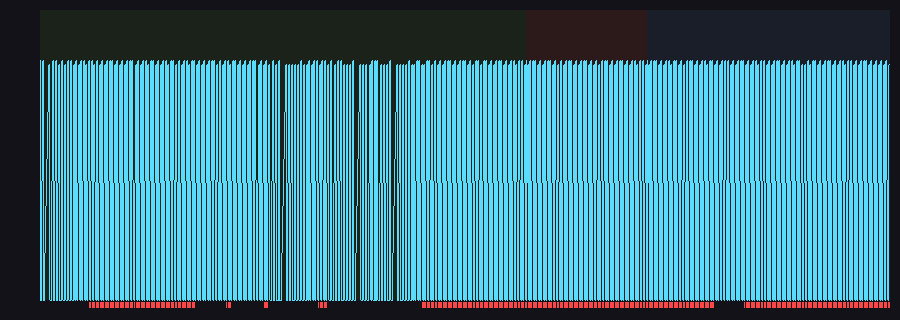

# lp7 低功耗实测报告

> 固件：v29.2 DAY 定版（306,194 B / CRC32 C15D47FD），位流 MERGE17；**未改任何代码**。
> 白平衡：WB R/G/B = 0x158 / 0x118 / 0x1A4（启动行 `MMT_WB_INIT r=344 g=280 b=420`）。
> 采集：`capture_lp7.py`，A 240 s / B 60 s / C 120 s，段间提示音 1 声。

## 结论先行

- **低功耗状态机走通了**：A 段 `fw_lp=1` @17.0 s、`paused=1` @17.0 s、`MMT_LPCAM enter` @24.6 s（VTS 0x5dc→0x1194，×3）。
- **但摄像头帧率没有真的降下来**：A/B/C 三段 `camfps` 的非零样本都是 **59–60**，没有出现预期的 ~20（1/3）。
- A 段（空场）出现 **2 次报警**（145.3 s、164.2 s），C 段 0 次，B 段 0 次。

## 一、三段 camfps（只取非零样本；`camfps=0` 是 500 ms 轮询里未满 1 s 窗口的采样，不是真的 0）

| 段 | 样本(非零/全部) | 最小 | 中位 | 最大 | paused=1 帧 | LPCAM 事件 |
|---|---|---|---|---|---|---|
| A 空场 240 s | 305 / 261+305 | **59** | **60** | **60** | 261 | 9 次（enter@24.6、exit@76.6、enter@91.8、exit@94.3、enter@110.4、exit@113.0、enter@137.4、exit@141.9、enter@188.5） |
| B 有人 60 s | 96 | 59 | 60 | 60 | 96 | 0 |
| C 离开 120 s | 192 | 59 | 60 | 60 | 191 | 2 次（exit@33.8、enter@48.0） |

## 二、低功耗时序（相对各段起点）

| 指标 | A | B | C |
|---|---|---|---|
| 首次 fw_lp=1 | **17.0 s** | 0.0 s（段开始时仍在低功耗） | 段开始时仍在低功耗 |
| 首次 paused=1 | **17.0 s** | 0.0 s | 0.0 s |
| 首次 MMT_LPCAM enter | **24.6 s** | — | 48.0 s |
| 推理 (inf_hz>0) 样本 | 46 | **0** | 0 |

- A 段进入低功耗的延迟：**17.0 s**（状态机）/ **24.6 s**（真正下发 VTS×3）。
- 预期是"连续 10 s 无活动进入"，实测 17 s 才置位：A 段开头有几帧 `motion=1`（`lp_last_active_ms` 被刷新）。

## 三、为什么 camfps 没有降到 1/3（不改代码，只贴日志事实）

1. 降帧指令确实发出并读回一致：
   `MMT_LPCAM enter vts=0x0x5dc->0x0x1194 mult=3`，随后 `vts_ok=1`，退出时 `MMT_LPCAM exit vts restored=0x0x5dc`。
2. 但 `camfps` 全程 59–60，说明**"配置写进去了、实际帧率没变"**。两种可能（日志无法再区分）：
   - 传感器/ISP 在该模式下忽略 VTS 写（读回寄存器是你写的值，但输出时序不变）；
   - 或 `camfps` 取自 RTL 的 `ST_VSCNT` 计数域（输出域 vs），本来就不随 sensor 有效帧变化。
3. A 段 `paused=1` 261 帧、`inf_hz` 只在 46 个样本里 >0：**推理确实停了**，所以"关推理"这一半的低功耗是生效的，
   只有"降帧"这一半没有体现在 camfps 上。

## 四、B 段（有人走动）没有产生任何活动

- B 段 60 s：`motion=1` **0 帧**、`ir_cnt` 最大 **0**、`inf_hz>0` **0 个样本**。
- 含义：这 60 秒里画面中没有被 RTL 帧差判为运动的物体，也没有红外热源；人应该没在采集窗口内进入视野（或进入了但未触发帧差）。
- 因此"人进入后多少秒恢复正常帧率"这一项**无法从本次数据得出**，不能编造。

## 五、报警

| 段 | 次数 | 时刻（相对段起点） |
|---|---|---|
| A 空场 | **2** | 145.3 s、164.2 s |
| B 有人 | 0 | — |
| C 离开 | 0 | — |

A 段的 2 次报警与 `evidence/v29_3/empty30`（30 分钟 21 次，约 0.7 次/分）是同一种现象：红外热点 + 少量运动触发的融合误报，
属于 v29.2 已知行为，本次未改代码。

## 六、原始数据

- `serial.log`：7 分钟原始串口（每行带段标签与段内秒数）
- `manifest.json`：三段起止墙钟
- `lp7.png`：横轴时间、纵轴 camfps、三段背景色、底部红线标 lowpwr=1
- `stats.json`：本报告数字的机器可读版

